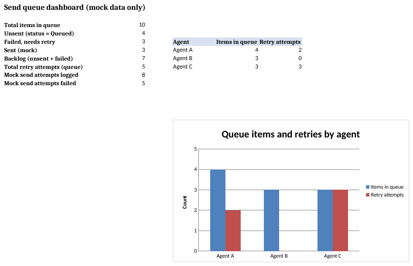
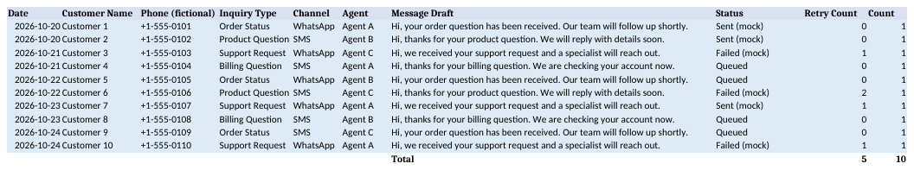
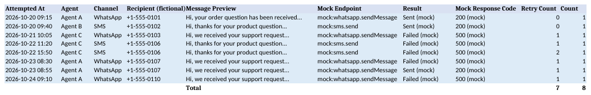

# Form-to-WhatsApp/SMS Notify Queue (sample)

For support or sales teams who want to see how Google Form responses could turn into a per-agent WhatsApp/SMS follow-up queue before any real messaging API is connected.

Each fictional form response becomes a queue row with a message draft, an assigned agent, a send status, and a retry count. A send log tracks mock attempts, and the dashboard shows unsent and failed counts across the whole queue. No WhatsApp Cloud API or Twilio SMS call is made anywhere in this sample. Every status value and response code comes from a mock export, not a live service.



All data in this sample is fictional.




## Tabs

| Tab | Purpose |
|-----|---------|
| Dashboard | Queue totals, unsent/failed/sent counts, backlog, and a per-agent chart |
| Send Queue | One row per fictional form response, with message draft, status, and retry count |
| Send Log | Mock send attempts with a fictional recipient, a mock endpoint name, and a mock response code |
| Lists (hidden) | Agents, channels, statuses, and inquiry types used for dropdown validation |

## How to try it

Build the workbook locally, open dist/form_to_whatsapp_sms_notify_queue.xlsx, and edit the light blue cells on Send Queue or Send Log (for example, change a Status to Queued) to see the Dashboard counts and chart update.

```bash
python3 tools/check_sheet_names.py job_config.json
python3 build_xlsx.py
python3 test/test_xlsx.py
python3 tools/make_screens.py
```

`build_xlsx.py` writes the workbook to `dist/` and keeps `src/Code.gs` in sync with `job_config.json` for the Google Sheets setup path.

## Note

All figures are fictional data; checked with LibreOffice recalculation and local tests.
